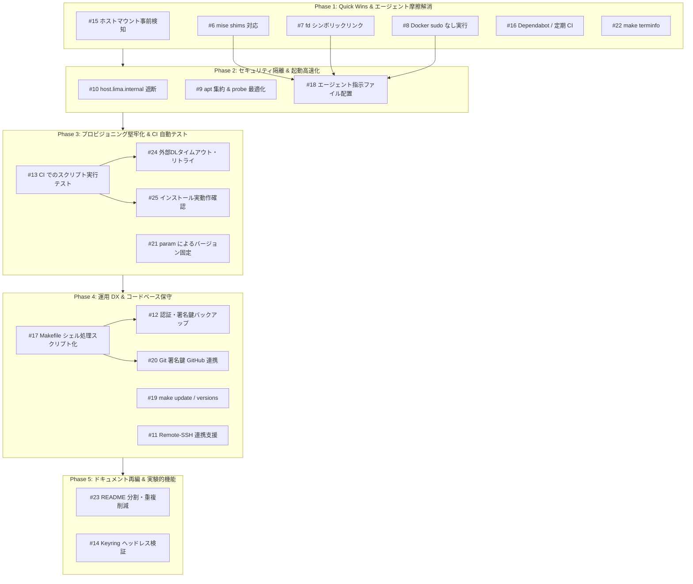

# Issue 評価基準・優先順位ロードマップ

本ドキュメントは、`lima-coding-sandbox` における未解決 Issue（計 20 件、#6〜#25）について、プロジェクトの目的・セキュリティ・開発効率の観点から評価基準を定め、実装の優先順位とロードマップを整理したものです。

---

## 1. プロジェクト方針と評価基準

本プロジェクトは **「コーディングエージェント（Antigravity CLI、GitHub Copilot CLI 等）が安全かつ自律的に作業できるサンドボックス環境」** の提供を目的としています。
そのため、以下の優先度設計に基づいて各 Issue を評価しています。

### 評価軸

| 軸 | レベル | 判定基準 |
|---|---|---|
| **重要度 (Importance)** | **高 (High)** | ・ホスト環境を保護するセキュリティ隔離の担保 ・エージェントが自律実行時にエラーや停止（摩擦）を起こす問題の解消 ・プロビジョニングの破損・失敗の防止 |
| | **中 (Medium)** | ・開発者の日常運用（DX）向上 ・コード保守性・CI の品質保証基盤 ・ドキュメントの肥大化・二重管理の解消 |
| | **低 (Low)** | ・既存のワークアラウンドや代替手段があり、当面致命的ではないもの |
| **難易度 (Complexity)** | **低 (Low)** | 数行〜局所的なスクリプト/設定の修正で済み、即座に効果が出る（Quick Win） |
| | **中 (Medium)** | 複数スクリプト、Makefile、YAML 間の連携や動作検証が必要 |
| | **高 (High)** | ヘッドレス環境固有の制約、外部サービス依存など不確実性が高く検証コストが大きい |

---

## 2. 全 Issue 優先度一覧

| 優先度 | # | タイトル | カテゴリ | 重要度 | 難易度 | 選定理由・依存関係 |
|:---:|:---:|---|---|:---:|:---:|---|
| **P1** | [#15](https://github.com/ikuy1203/lima-coding-sandbox/issues/15) | [Security] make create / make start でホストのマウントを起動前に検出する | Security | **高** | **低** | **Quick Win**。ホストファイルの意図しない露出を VM 起動前に確実に阻止する。Issue に具体的な判定スクリプト案あり。 |
| **P1** | [#7](https://github.com/ikuy1203/lima-coding-sandbox/issues/7) | [Agent DX] fd コマンド互換シンボリックリンクの自動作成 | Agent DX | **高** | **低** | **Quick Win**。エージェントが `fd` 実行時に `command not found` で失敗する摩擦を 1 行で根本解決。 |
| **P1** | [#8](https://github.com/ikuy1203/lima-coding-sandbox/issues/8) | [Agent DX] Docker コマンドの sudo なし実行またはラッパーの提供 | Agent DX | **高** | **低** | **Quick Win**。エージェントが `docker` を直接叩いて Permission Denied で落ちる最大の摩擦を解消。 |
| **P1** | [#6](https://github.com/ikuy1203/lima-coding-sandbox/issues/6) | [Agent DX] mise の shims を導入し非対話シェルでのランタイム自動切替を可能にする | Agent DX | **高** | **低〜中** | エージェントのサブシェル（`bash -c`）でプロジェクト固有の言語バージョンが反映されない問題を解決（エージェント自律性の根幹）。 |
| **P1** | [#16](https://github.com/ikuy1203/lima-coding-sandbox/issues/16) | [CI] Dependabot の導入と CI の定期実行（schedule）の追加 | CI | **中** | **低** | **Quick Win**。数行の YAML 追加で GitHub Actions や Lima 上流リリースの陳腐化・破壊を定期検知。 |
| **P1** | [#22](https://github.com/ikuy1203/lima-coding-sandbox/issues/22) | [DX] ホストの terminfo を VM にコピーする make terminfo の追加 | DX | **低〜中** | **低** | **Quick Win**。Ghostty などの端末で必要に応じて 1 コマンドでホストの terminfo を同期可能にする。 |
| **P2** | [#10](https://github.com/ikuy1203/lima-coding-sandbox/issues/10) | [Security] host.lima.internal（ホストループバック）への通信遮断とポートフォワーディング制御 | Security | **高** | **中** | サンドボックス内からホスト側マシンのローカルサービス（DBや管理画面等）への意図しない到達を遮断する中核セキュリティ。 |
| **P2** | [#9](https://github.com/ikuy1203/lima-coding-sandbox/issues/9) | [Provisioning] apt-get update の集約と probe 待機処理の最適化による起動高速化 | Performance | **高** | **中** | `apt-get update` の重複実行（計6回）の解消と probe の一括チェック化により、VM 作成・起動時間を大幅短縮。 |
| **P2** | [#18](https://github.com/ikuy1203/lima-coding-sandbox/issues/18) | [Agent DX] VM の前提をまとめたエージェント向けの指示ファイルを provision で配置する | Agent DX | **高** | **低〜中** | #6, #7, #8 を先行解決した後に配置することで、「sudo docker を使え」「mise exec を使え」等の無駄な回避指示を省いた洗練された前提指示を提供できる。 |
| **P3** | [#13](https://github.com/ikuy1203/lima-coding-sandbox/issues/13) | [CI] GitHub Actions でのプロビジョニングスクリプト実行テストの追加 | CI | **高** | **中〜高** | プロビジョニング改修（#24, #25, #21）のデグレを防ぐための自動テスト基盤。CI 上で構文だけでなく実行可能性を保証。 |
| **P3** | [#24](https://github.com/ikuy1203/lima-coding-sandbox/issues/24) | [Provisioning] 外部ダウンロードのタイムアウト・リトライと失敗時の回復を整備する | Provisioning | **高** | **中** | 初回プロビジョニング時の一時的ネットワーク障害による破損スクリプト実行・途中終了を防止。一時ファイル利用と trap で確実な後始末を行う。 |
| **P3** | [#25](https://github.com/ikuy1203/lima-coding-sandbox/issues/25) | [Provisioning] インストール済み判定と probes を配布元・実動作の確認に強化する | Provisioning | **高** | **中** | ファイル存在確認（`-x`）だけでなく `--version` や公式 apt リポジトリの整合性まで検証し、破損・誤判定を防止。 |
| **P3** | [#21](https://github.com/ikuy1203/lima-coding-sandbox/issues/21) | [Provisioning] サードパーティツールのバージョンを param で固定できるようにする | Provisioning | **中〜高** | **中** | Copilot CLI や mise 等の上流更新による突然の破壊を防ぎ、再現可能なサンドボックス環境を実現。 |
| **P4** | [#17](https://github.com/ikuy1203/lima-coding-sandbox/issues/17) | [CI] Makefile のシェル処理を scripts/ に移して shellcheck の対象にする | CI / Maintenance | **中** | **低〜中** | Makefile 内の複雑なインラインスクリプトを `scripts/` に切り出し、shellcheck で自動検査。Makefile 拡張の保守性を向上。 |
| **P4** | [#12](https://github.com/ikuy1203/lima-coding-sandbox/issues/12) | [DX] VM 再作成（make recreate）時の認証情報・署名鍵バックアップ支援 | DX | **中〜高** | **中** | `make recreate` のたびに認証セッションや Git コミット署名鍵が消える心理的ハードルを解消。 |
| **P4** | [#20](https://github.com/ikuy1203/lima-coding-sandbox/issues/20) | [DX] Git の署名鍵の GitHub への登録・削除をホストの gh で支援する | DX | **中** | **中** | ホスト側の `gh` を利用して署名鍵の登録・削除を支援。鍵コメントに作成日・インスタンス名を含めて識別性を向上。 |
| **P4** | [#19](https://github.com/ikuy1203/lima-coding-sandbox/issues/19) | [DX] ツールを一括更新する make update と、バージョンを表示する make versions の追加 | DX | **中** | **低** | VM 内の複数ツールの更新・状態把握をホストから 1 コマンドで実行可能にする。 |
| **P4** | [#11](https://github.com/ikuy1203/lima-coding-sandbox/issues/11) | [DX] VS Code / Cursor Remote - SSH 連携のサポート（make ssh-config の追加） | DX | **中** | **低** | ホスト側の VS Code / Cursor から VM 内のワークスペースに Remote-SSH で接続する設定・手順の提供。 |
| **P5** | [#23](https://github.com/ikuy1203/lima-coding-sandbox/issues/23) | [Docs] ツール一覧などの重複記載の削減と README の分割 | Docs | **中** | **中** | README（41KB）の肥大化解消と二重管理防止。機能改修が落ち着いた段階で一括整理する方が手戻りが少ない。 |
| **P5** | [#14](https://github.com/ikuy1203/lima-coding-sandbox/issues/14) | [Agent DX] Antigravity CLI 向けの Secret Service（Keyring）ヘッドレス対応の検証 | Agent DX | **低〜中** | **高** | 現状 Gemini API キー方式で正常動作しており、ヘッドレス D-Bus/Keyring は不確実性が高いため後回しを推奨。 |

---

## 3. 実装ロードマップ（推奨着手順）

依存関係と投資対効果（ROI）を考慮した 5 つのフェーズです。

### Phase 1: Quick Wins & エージェント摩擦解消（即効性）
- **目的**: 最小限の変更で、重大なセキュリティ漏れ（ホストマウント）の防止と、エージェントがコマンドを実行する際の典型的なエラーを排除する。
- **対象**:
  - **#15 [Security]**: `make create` / `make start` 前に `limactl template yq` および `limactl list` でマウントを検査
  - **#7 [Agent DX]**: `provision/base-packages.sh` で `fd` のシンボリックリンク作成
  - **#8 [Agent DX]**: 通常ユーザの `docker` グループ追加または sudo ラッパー設置
  - **#6 [Agent DX]**: `~/.local/share/mise/shims` を PATH に含め、非対話サブシェルでも言語バージョンを自動反映
  - **#16 [CI]**: `.github/dependabot.yml` 追加と CI schedule 設定
  - **#22 [DX]**: `make terminfo` ターゲット追加

### Phase 2: セキュリティ隔離 & 起動高速化（基盤強化）
- **目的**: サンドボックスのホスト防御を完成させ、プロビジョニングの体感速度を大幅に引き上げる。
- **対象**:
  - **#10 [Security]**: iptables/nftables による `host.lima.internal` へのアクセス遮断と、`portForwards` の明示
  - **#9 [Provisioning]**: サードパーティリポジトリ登録を先行させ、`apt-get update` を 1 回に集約。probe のコマンド判定をループから一括確認へリファクタリング
  - **#18 [Agent DX]**: Phase 1 で解決した項目（fd, docker, mise）を踏まえ、本当に必要な VM 前提のみをまとめた指示ファイルを provision で配置

### Phase 3: プロビジョニング堅牢化 & CI 自動検証（安定性）
- **目的**: ネットワーク障害や上流ツールの破壊的変更に強い再現可能な環境を作る。
- **対象**:
  - **#13 [CI]**: GitHub Actions 上でプロビジョニングスクリプトを実行するテストジョブを追加（後続のセーフティネット）
  - **#24 [Provisioning]**: 外部ダウンロード共通処理（タイムアウト、リトライ、一時ファイルダウンロード、trap 処理）の導入
  - **#25 [Provisioning]**: probe および provision スクリプトでの `--version` 起動確認・公式リポジトリ確認
  - **#21 [Provisioning]**: `coding-sandbox.yaml` の `param` や `.env` からツールバージョンを指定可能にする

### Phase 4: 運用 DX & コードベース保守（利便性）
- **目的**: 開発者が日常的に VM を破棄・再作成しやすくし、Makefile のメンテナンス性を高める。
- **対象**:
  - **#17 [CI]**: Makefile 内の複雑なインラインスクリプトを `scripts/` に切り出して shellcheck 対象化
  - **#12 [DX]** & **#20 [DX]**: `make backup-auth`, `make restore-auth`, `make register-key` 等で認証・署名鍵の退避・登録を支援
  - **#19 [DX]**: `make update`, `make versions` の追加
  - **#11 [DX]**: `make ssh-config` の追加と Remote-SSH ドキュメントの拡充

### Phase 5: ドキュメント再編 & 実験的機能（仕上げ）
- **目的**: 変更が一段落した段階でドキュメントを整理し、難易度の高い実験的検証を行う。
- **対象**:
  - **#23 [Docs]**: README から `docs/` への分割（セキュリティ、認証、トラブルシューティング）、記載の重複排除、`scripts/lint.sh` での記載検査
  - **#14 [Agent DX]**: Antigravity CLI 向けの Secret Service（Keyring）ヘッドレス自動アンロックの技術検証
