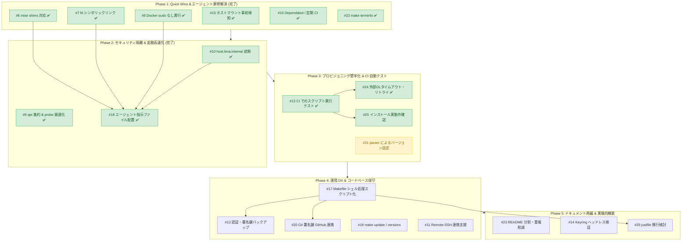

# Issue 評価基準・優先順位ロードマップ

本ドキュメントは、`lima-coding-sandbox` の Issue（計 21 件、#6〜#25・#29）について、プロジェクトの目的・セキュリティ・開発効率の観点から評価基準を定め、実装の優先順位とロードマップを整理したものです。

> **最終更新: 2026-11-01** — 完了 12 件 / 未解決 9 件。Phase 1、Phase 2 に続き、**Phase 3**（#13, #24, #25）が進行中です（次は #21）。

---

## 0. 進捗状況

### サマリ

| Phase | 対象 Issue | 完了 | 状態 |
|---|---|:---:|---|
| Phase 1: Quick Wins & エージェント摩擦解消 | #15, #7, #8, #6, #16, #22 | 6 / 6 | ✅ 完了 |
| Phase 2: セキュリティ隔離 & 起動高速化 | #10, #9, #18 | 3 / 3 | ✅ 完了 |
| Phase 3: プロビジョニング堅牢化 & CI 自動テスト | #13, #24, #25, #21 | 3 / 4 | 🔄 進行中（完了: #13, #24, #25） |
| Phase 4: 運用 DX & コードベース保守 | #17, #12, #20, #19, #11 | 0 / 5 | 未着手 |
| Phase 5: ドキュメント再編 & 実験的機能 | #23, #14, #29 | 0 / 3 | 未着手 |

### 完了済み Issue

| # | タイトル | PR | マージ日 (JST) | 実装内容 |
|:---:|---|:---:|:---:|---|
| [#15](https://github.com/ikuy1203/lima-coding-sandbox/issues/15) | [Security] make create / make start でホストのマウントを起動前に検出する | [#26](https://github.com/ikuy1203/lima-coding-sandbox/pull/26) | 2026-10-10 | `make create` はマウント設定があれば作成を拒否。`make start` は起動を拒否し、起動中なら停止。`limactl start` 失敗時もマウントを検出したら VM を停止し、元の終了コードを保持 |
| [#7](https://github.com/ikuy1203/lima-coding-sandbox/issues/7) | [Agent DX] fd コマンド互換シンボリックリンクの自動作成 | [#27](https://github.com/ikuy1203/lima-coding-sandbox/pull/27) | 2026-10-10 | `provision/base-packages.sh`（#9 で `apt-packages.sh` に改名）で `fdfind` → `fd` のシンボリックリンクを作成し、probe も `fd` で確認 |
| [#8](https://github.com/ikuy1203/lima-coding-sandbox/issues/8) | [Agent DX] Docker コマンドの sudo なし実行またはラッパーの提供 | [#28](https://github.com/ikuy1203/lima-coding-sandbox/pull/28) | 2026-10-11 | `docker` グループ方式ではなく、`/usr/local/bin/docker` に `exec sudo -n /usr/bin/docker "$@"` のラッパーを配置。probe で `sudo` なしの `docker info` を確認。**制約**: `sudo` 経由のため呼び出し元の環境変数（`TAG=dev docker compose up` 等）や `HOME` は保持されない |
| [#16](https://github.com/ikuy1203/lima-coding-sandbox/issues/16) | [CI] Dependabot の導入と CI の定期実行（schedule）の追加 | [#30](https://github.com/ikuy1203/lima-coding-sandbox/pull/30) | 2026-10-11 | `.github/dependabot.yml` を追加し、`ci.yml` に週次の schedule 実行を追加 |
| [#22](https://github.com/ikuy1203/lima-coding-sandbox/issues/22) | [DX] ホストの terminfo を VM にコピーする make terminfo の追加 | [#31](https://github.com/ikuy1203/lima-coding-sandbox/pull/31) | 2026-10-11 | `make terminfo` ターゲットを追加 |
| [#6](https://github.com/ikuy1203/lima-coding-sandbox/issues/6) | [Agent DX] mise の shims を導入し非対話シェルでのランタイム自動切替を可能にする | [#32](https://github.com/ikuy1203/lima-coding-sandbox/pull/32) | 2026-10-11 | インストーラを `https://mise.run` に切り替え、`~/.profile` で `~/.local/share/mise/shims` を PATH の先頭に追加。probe でログインシェルの PATH 先頭に shims があることを確認 |
| [#9](https://github.com/ikuy1203/lima-coding-sandbox/issues/9) | [Provisioning] apt-get update の集約と probe 待機処理の最適化による起動高速化 | [#34](https://github.com/ikuy1203/lima-coding-sandbox/pull/34) | 2026-10-11 | `base-packages.sh` を `apt-packages.sh` に改名し、リポジトリ登録（`github-cli.sh`・`docker-engine.sh`）を先行させて `apt-get update` と apt パッケージ導入を 1 回に集約（公式インデックス確認・グループ別フォールバック付き）。`basic tools` と CLI バイナリの probe を一括確認方式に刷新 |
| [#10](https://github.com/ikuy1203/lima-coding-sandbox/issues/10) | [Security] host.lima.internal（ホストループバック）への通信遮断とポートフォワーディング制御 | [#35](https://github.com/ikuy1203/lima-coding-sandbox/pull/35) | 2026-10-11 | `provision/host-loopback-firewall.sh` と `lima-coding-sandbox-firewall.service` で VM・Docker コンテナから `host.lima.internal` への接続を nftables で遮断（DNS 通信は維持、`blockHostLoopback=false` で無効化可）。`portForwards` で自動ポート転送を全面無効化し、手動転送用の `make forward` を追加 |
| [#18](https://github.com/ikuy1203/lima-coding-sandbox/issues/18) | [Agent DX] VM の前提をまとめたエージェント向けの指示ファイルを provision で配置する | [#37](https://github.com/ikuy1203/lima-coding-sandbox/pull/37) | 2026-10-27 | VM 前提（マウントなし、sudo、docker ラッパー制約、mise shims、手動ポート転送、nftables 遮断等）をまとめた指示ファイルを配置。Copilot CLI（`~/.copilot/copilot-instructions.md` のマーカーブロック）と Antigravity CLI（`~/.gemini/config/rules/lima-coding-sandbox.md` の always_on ルール）に対応。既定は配置しない方針（`param.agentInstructions: "false"`）とし、オプトインで有効化可能 |
| [#13](https://github.com/ikuy1203/lima-coding-sandbox/issues/13) | [CI] GitHub Actions でのプロビジョニングスクリプト実行テストの追加 | [#38](https://github.com/ikuy1203/lima-coding-sandbox/pull/38) | 2026-10-29 | 高速スタブ回帰テストスイート（`scripts/test.sh`）を整備し `scripts/lint.sh` とともにローカルおよび CI で自動実行。GitHub Actions 上で Ubuntu + KVM アクセラレーションによる Lima VM 起動・全 provision & probes 検証、CLI 動作確認、Git 署名検証、VM 再起動による冪等性テストを構築 |
| [#24](https://github.com/ikuy1203/lima-coding-sandbox/issues/24) | [Provisioning] 外部ダウンロードのタイムアウト・リトライと失敗時の回復を整備する | [#43](https://github.com/ikuy1203/lima-coding-sandbox/pull/43) | 2026-11-01 | 外部インストーラ（herdr, agy, copilot, mise）および apt 鍵（GitHub CLI, Docker Engine）の取得処理にタイムアウト・限定回数リトライ・恒久/一時エラー判別を導入。一時ファイルへのダウンロード完了後にのみ実行・配置し `trap` で確実に消去。スタブ回帰テストスイートを拡張 |
| [#25](https://github.com/ikuy1203/lima-coding-sandbox/issues/25) | [Provisioning] インストール済み判定と probes を配布元・実動作の確認に強化する | [#44](https://github.com/ikuy1203/lima-coding-sandbox/pull/44) | 2026-11-01 | GitHub CLI の公式 apt リポジトリ配布元・実動作検証、CLI ツール（herdr, agy, copilot, mise）のタイムアウト付き `--version` 実動作確認と破損時再導入、Git 署名鍵整合性と一時リポジトリでの署名・検証診断、および `coding-sandbox.yaml` probes の配布元・実動作・署名検証強化 |

### 前回からの変更点

- **#25（インストール済み判定と probes の実動作・配布元検証強化）が完了**:
  - `github-cli.sh` および `apt-packages.sh` で公式リポジトリ設定の健全性・公式配布元（Maintainer / policy）を検証し、Ubuntu universe 版 gh の誤認スキップを防止。
  - 各 CLI（herdr, agy, copilot, mise）の `verify_cli` によるタイムアウト付き `--version` 起動確認を導入し、破損バイナリの自動再インストールとインストーラ実行直後の動作確認を整備。
  - `git-config.sh` で鍵ペア整合性確認、独自設定保持、および一時リポジトリでの署名コミット・検証診断を導入。
  - `coding-sandbox.yaml` の probes（basic tools, CLI tools, Git 署名）を実動作確認・エラー理由明示に強化。
  - `scripts/test.sh` に 44 件の新規テストを追加（計 73 件）。
- **後続フェーズへの反映**:
  - Phase 3 の残る課題は **#21**（サードパーティツールのバージョンを param で固定できるようにする）。
  - 次の着手推奨は **#21**。

---

## 1. プロジェクト方針と評価基準

本プロジェクトは **「コーディングエージェント（Antigravity CLI、GitHub Copilot CLI 等）が安全かつ自律的に作業できるサンドボックス環境」** の提供を目的としています。
そのため、以下の優先度設計に基づいて各 Issue を評価しています。

### 評価軸

| 軸 | レベル | 判定基準 |
|---|---|---|
| **重要度 (Importance)** | **高 (High)** | ・ホスト環境を保護するセキュリティ隔離の担保 ・エージェントが自律実行時にエラーや停止（摩擦）を起こす問題の解消 ・プロビジョニングの破損・失敗の防止 |
| | **中 (Medium)** | ・開発者の日常運用（DX）向上 ・コード保守性・CI の品質保証基盤 ・ドキュメントの肥大化・二重管理の解消 |
| | **低 (Low)** | ・既存のワークアラウンドや代替手段があり、当面致命的ではないもの |
| **難易度 (Complexity)** | **低 (Low)** | 数行〜局所的なスクリプト/設定の修正で済み、即座に効果が出る（Quick Win） |
| | **中 (Medium)** | 複数スクリプト、Makefile、YAML 間の連携や動作検証が必要 |
| | **高 (High)** | ヘッドレス環境固有の制約、外部サービス依存など不確実性が高く検証コストが大きい |

---

## 2. 未解決 Issue 優先度一覧

| 優先度 | # | タイトル | カテゴリ | 重要度 | 難易度 | 選定理由・依存関係 |
|:---:|:---:|---|---|:---:|:---:|---|
| **P3** | [#13](https://github.com/ikuy1203/lima-coding-sandbox/issues/13) | [CI] GitHub Actions でのプロビジョニングスクリプト実行テストの追加 | CI | **高** | **中〜高** | プロビジョニング改修（#24, #25, #21）のデグレを防ぐための自動テスト基盤。CI 上で構文だけでなく実行可能性を保証。#16 の週次 schedule 実行と組み合わせると上流の破壊も検知できる。 |
| **P3** | [#24](https://github.com/ikuy1203/lima-coding-sandbox/issues/24) | [Provisioning] 外部ダウンロードのタイムアウト・リトライと失敗時の回復を整備する | Provisioning | **高** | **中** | 初回プロビジョニング時の一時的ネットワーク障害による破損スクリプト実行・途中終了を防止。#9 で `docker-engine.sh` の鍵取得は一時ファイル化されたため、残る `curl ... \| sh` スクリプトの一時ファイル取得、タイムアウト・リトライ、および `trap` による確実な後始末を整備する。 |
| **P3** | [#25](https://github.com/ikuy1203/lima-coding-sandbox/issues/25) | [Provisioning] インストール済み判定と probes を配布元・実動作の確認に強化する | Provisioning | **高** | **中** | #9 で `github-cli.sh` の設定ファイル判定と `apt-packages.sh` の公式候補確認が導入された。これに加え、既存環境の配布元整合性や、CLI のファイル存在確認（`-x`）にとどまらない `--version` 実動作確認、Git 署名設定の診断を強化し、破損・誤判定を防止する。 |
| **P3** | [#21](https://github.com/ikuy1203/lima-coding-sandbox/issues/21) | [Provisioning] サードパーティツールのバージョンを param で固定できるようにする | Provisioning | **中〜高** | **中** | Copilot CLI や mise 等の上流更新による突然の破壊を防ぎ、再現可能なサンドボックス環境を実現。 |
| **P4** | [#17](https://github.com/ikuy1203/lima-coding-sandbox/issues/17) | [CI] Makefile のシェル処理を scripts/ に移して shellcheck の対象にする | CI / Maintenance | **中** | **低〜中** | Makefile（228 行）内の複雑なインラインスクリプト（#15 のマウント検出、#22 の terminfo、#10 の `forward`・`BLOCK_HOST_LOOPBACK` 検証など）を `scripts/` に切り出し、shellcheck で自動検査。#12, #20, #29 の前提。 |
| **P4** | [#12](https://github.com/ikuy1203/lima-coding-sandbox/issues/12) | [DX] VM 再作成（make recreate）時の認証情報・署名鍵バックアップ支援 | DX | **中〜高** | **中** | `make recreate` のたびに認証セッションや Git コミット署名鍵が消える心理的ハードルを解消。 |
| **P4** | [#20](https://github.com/ikuy1203/lima-coding-sandbox/issues/20) | [DX] Git の署名鍵の GitHub への登録・削除をホストの gh で支援する | DX | **中** | **中** | ホスト側の `gh` を利用して署名鍵の登録・削除を支援。鍵コメントに作成日・インスタンス名を含めて識別性を向上。 |
| **P4** | [#19](https://github.com/ikuy1203/lima-coding-sandbox/issues/19) | [DX] ツールを一括更新する make update と、バージョンを表示する make versions の追加 | DX | **中** | **低** | VM 内の複数ツールの更新・状態把握をホストから 1 コマンドで実行可能にする。 |
| **P4** | [#11](https://github.com/ikuy1203/lima-coding-sandbox/issues/11) | [DX] VS Code / Cursor Remote - SSH 連携のサポート（make ssh-config の追加） | DX | **中** | **低** | ホスト側の VS Code / Cursor から VM 内のワークスペースに Remote-SSH で接続する設定・手順の提供。 |
| **P5** | [#23](https://github.com/ikuy1203/lima-coding-sandbox/issues/23) | [Docs] ツール一覧などの重複記載の削減と README の分割 | Docs | **中** | **中** | README（655 行）の肥大化解消と二重管理防止。機能改修が落ち着いた段階で一括整理する方が手戻りが少ない。 |
| **P5** | [#14](https://github.com/ikuy1203/lima-coding-sandbox/issues/14) | [Agent DX] Antigravity CLI 向けの Secret Service（Keyring）ヘッドレス対応の検証 | Agent DX | **低〜中** | **高** | 現状 Gemini API キー方式で正常動作しており、ヘッドレス D-Bus/Keyring は不確実性が高いため後回しを推奨。 |
| **P5** | [#29](https://github.com/ikuy1203/lima-coding-sandbox/issues/29) | [DX] Makefile を justfile に移行するか検討する（#17 の後） | DX | **低** | **中** | 検証の結果、そのまま置き換えると `.env` の書式・`ENV_FILE`・変数の優先順位などで非互換が出ることが判明。shellcheck の課題は just でも解決しないため、**#17 を先行**し、引数渡し等の具体的な要望が出た段階で「薄い justfile から `scripts/*.sh` を呼ぶ形」を再検討する。 |

---

## 3. 実装ロードマップ（推奨着手順）

依存関係と投資対効果（ROI）を考慮した 5 つのフェーズです。

### Phase 1: Quick Wins & エージェント摩擦解消（即効性） — ✅ 完了（2026-10-11）
- **目的**: 最小限の変更で、重大なセキュリティ漏れ（ホストマウント）の防止と、エージェントがコマンドを実行する際の典型的なエラーを排除する。
- **対象**:
  - ✅ **#15 [Security]**: `make create` / `make start` 前にマウントを検査（PR #26）
  - ✅ **#7 [Agent DX]**: `provision/base-packages.sh`（現 `apt-packages.sh`）で `fd` のシンボリックリンク作成（PR #27）
  - ✅ **#8 [Agent DX]**: `/usr/local/bin/docker` に sudo ラッパーを設置（PR #28）
  - ✅ **#6 [Agent DX]**: `~/.local/share/mise/shims` を PATH に含め、非対話サブシェルでも言語バージョンを自動反映（PR #32）
  - ✅ **#16 [CI]**: `.github/dependabot.yml` 追加と CI の週次 schedule 設定（PR #30）
  - ✅ **#22 [DX]**: `make terminfo` ターゲット追加（PR #31）

### Phase 2: セキュリティ隔離 & 起動高速化（基盤強化） — ✅ 完了（2026-10-27）
- **目的**: サンドボックスのホスト防御を完成させ、エージェントへの前提共有を自動化し、プロビジョニングの体感速度を大幅に引き上げる。
- **対象**:
  - ✅ **#10 [Security]**: nftables（`provision/host-loopback-firewall.sh`）と systemd ユニットによる `host.lima.internal` へのアクセス遮断、`portForwards` による自動ポート転送の全面無効化、および手動転送用の `make forward` ターゲットの追加（PR #35）
  - ✅ **#9 [Provisioning]**: サードパーティリポジトリ登録を先行させ、`provision/apt-packages.sh` で `apt-get update` とパッケージ導入を 1 回に集約。probe のコマンド・バイナリ判定を一括確認方式へリファクタリング（PR #34）
  - ✅ **#18 [Agent DX]**: Phase 1（fd, docker, mise）および #10（自動ポート転送の無効化・ホストループバック遮断）で確定した仕様を踏まえ、必要な VM 前提をまとめた指示ファイルを provision で配置。docker ラッパーの制約（環境変数・`HOME` が引き継がれない）や手動ポート転送（`make forward`）の案内を含める。既定は配置しない（`agentInstructions: "false"`）オプトイン方式

### Phase 3: プロビジョニング堅牢化 & CI 自動検証（安定性）
- **目的**: ネットワーク障害や上流ツールの破壊的変更に強い再現可能な環境を作る。
- **対象**:
  - ✅ **#13 [CI]**: GitHub Actions 上でプロビジョニングスクリプトを実行するテストジョブおよびローカル回帰テストスイートを追加（PR #38）
  - ✅ **#24 [Provisioning]**: 外部インストーラおよび apt 鍵の取得処理にタイムアウト・限定回数のリトライ・恒久/一時エラー判別を導入し、一時ファイルへのダウンロード完了後にのみ実行・配置する堅牢化と trap 後始末
  - ✅ **#25 [Provisioning]**: probe および provision スクリプトでの `--version` 起動確認・公式リポジトリ確認・Git 署名設定の診断強化
  - **#21 [Provisioning]**: `coding-sandbox.yaml` の `param` や `.env` からツールバージョンを指定可能にする

### Phase 4: 運用 DX & コードベース保守（利便性）
- **目的**: 開発者が日常的に VM を破棄・再作成しやすくし、Makefile のメンテナンス性を高める。
- **対象**:
  - **#17 [CI]**: Makefile 内の複雑なインラインスクリプトを `scripts/` に切り出して shellcheck 対象化
  - **#12 [DX]** & **#20 [DX]**: `make backup-auth`, `make restore-auth`, `make register-key` 等で認証・署名鍵の退避・登録を支援
  - **#19 [DX]**: `make update`, `make versions` の追加
  - **#11 [DX]**: `make ssh-config` の追加と Remote-SSH ドキュメントの拡充

### Phase 5: ドキュメント再編 & 実験的機能（仕上げ）
- **目的**: 変更が一段落した段階でドキュメントを整理し、難易度の高い実験的検証を行う。
- **対象**:
  - **#23 [Docs]**: README から `docs/` への分割（セキュリティ、認証、トラブルシューティング）、記載の重複排除、`scripts/lint.sh` での記載検査
  - **#14 [Agent DX]**: Antigravity CLI 向けの Secret Service（Keyring）ヘッドレス自動アンロックの技術検証
  - **#29 [DX]**: #17 完了後、引数渡しやサブディレクトリ実行などの具体的な要望がある場合に、`.env` をスクリプト側で読む「薄い justfile」への移行を判断する
